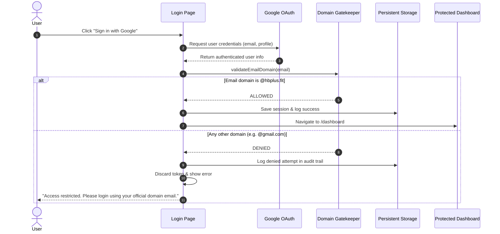

# HB+ Secure Portal

A cross-platform **React Native (Web & Mobile)** application with **Google OAuth 2.0** and strict **Domain Restriction** (`@hbplus.fit`).

---

## 🚀 Key Features

* **Cross-Platform**: Runs on **Web (Browser)** and **Mobile (Android & iOS)** from a single codebase.
* **Google OAuth 2.0 (PKCE)**: Official Google-branded sign-in with loading and error states.
* **Domain Gatekeeper**: Strictly allows `@hbplus.fit` emails; blocks all other domains (e.g. `@gmail.com`) with:
  > *"Access restricted. Please login using your official domain email."*
* **Protected Routes**: Direct URL access to `#/dashboard` without login is blocked; auto-redirects to `#/login`.
* **Interactive Test Suite**: One-click test accounts directly on the login screen to test allowed vs. restricted domains without needing Google Cloud credentials.
* **Role-Based Access Control (Bonus)**: Admin vs. Staff User views; Admins can toggle user roles.
* **Audit Trail (Bonus)**: Real-time logging of allowed/denied login attempts, timestamps, and domains.

---

## 🛠 Quick Start

### 1. Installation
```bash
git clone https://github.com/jackofallcodes5/hbplus-assignment.git
cd hbplus-assignment
npm install
```

### 2. Run the App
```bash
# Run on Web (Browser at http://localhost:8081)
npm run web

# Run on Android (Emulator / Device)
npm run android

# Run on iOS (Simulator - macOS)
npm run ios
```

### 3. Run Tests & Verification
```bash
# Automated unit tests for domain validator
npm test

# TypeScript typecheck
npx tsc --noEmit
```

---

## 🔄 Authentication Flow



### Flow Summary:
1. **Login Trigger**: User clicks the Google Sign-In button.
2. **OAuth Handshake**: `expo-auth-session` handles the PKCE flow and fetches the Google user profile.
3. **Gatekeeper Interception**: The authenticated email is validated **before** creating a session:
   * **Allowed (`@hbplus.fit`)**: Stored in persistent database, session granted, redirected to Dashboard.
   * **Restricted (e.g. `@gmail.com`)**: Token wiped immediately, violation logged, access denied.
4. **Session Persistence**: Sessions persist in AsyncStorage; unauthenticated visits to `#/dashboard` redirect to `#/login`.
5. **Logout**: Clears stored session tokens and returns to the login screen.

---

## 🛡️ How Domain Restriction Works

The validation logic lives in [`src/utils/domainValidator.ts`](src/utils/domainValidator.ts):

```typescript
export function validateEmailDomain(email: string, allowedDomain = 'hbplus.fit') {
  if (!email) return { isValid: false, error: 'Invalid email' };
  
  const cleanEmail = email.trim().toLowerCase();
  const parts = cleanEmail.split('@');

  // Enforce single @ and exact RHS hostname match
  if (parts.length === 2 && parts[1] === allowedDomain.toLowerCase()) {
    return { isValid: true, domain: parts[1] };
  }

  return {
    isValid: false,
    domain: parts[1] || 'unknown',
    error: 'Access restricted. Please login using your official domain email.',
  };
}
```

### Security Highlights:
* **Exact Domain Matching**: Matches only the exact domain after `@`, preventing spoofing like `user@hbplus.fit.evil.com` or `user@fakehbplus.fit`.
* **Normalization**: Trims leading/trailing whitespace and lowercases input.
* **Immediate Revocation**: Discards OAuth tokens on domain mismatch so unauthorized data never enters memory.
* **Cold-Start Verification**: Stored sessions are re-validated on app startup to prevent local storage tampering.

---

## ⚙️ Environment Configuration (Optional)

Copy `.env.example` to `.env` to configure your own Google OAuth Client IDs or Supabase credentials:

```ini
EXPO_PUBLIC_ALLOWED_DOMAIN=hbplus.fit
EXPO_PUBLIC_GOOGLE_CLIENT_ID_WEB=your-web-client-id.apps.googleusercontent.com
EXPO_PUBLIC_GOOGLE_CLIENT_ID_IOS=your-ios-client-id.apps.googleusercontent.com
EXPO_PUBLIC_GOOGLE_CLIENT_ID_ANDROID=your-android-client-id.apps.googleusercontent.com
EXPO_PUBLIC_SUPABASE_URL=https://your-project.supabase.co
EXPO_PUBLIC_SUPABASE_ANON_KEY=your-anon-key
```

---

## 📁 Project Structure

```
├── App.tsx                      # Root Navigator with protected route guard
├── src/
│   ├── components/              # GoogleSignInButton, ErrorBanner, Navbar,
│   │                            # QuickTestSelector, UserTable, AuditLogTable
│   ├── context/AuthContext.tsx  # Authentication state & gatekeeper logic
│   ├── screens/                 # LoginScreen, DashboardScreen
│   ├── services/database.ts     # Persistent storage for users & audit logs
│   └── utils/
│       ├── domainValidator.ts   # Domain gatekeeper logic
│       └── domainValidator.test.ts # Automated unit tests
```
