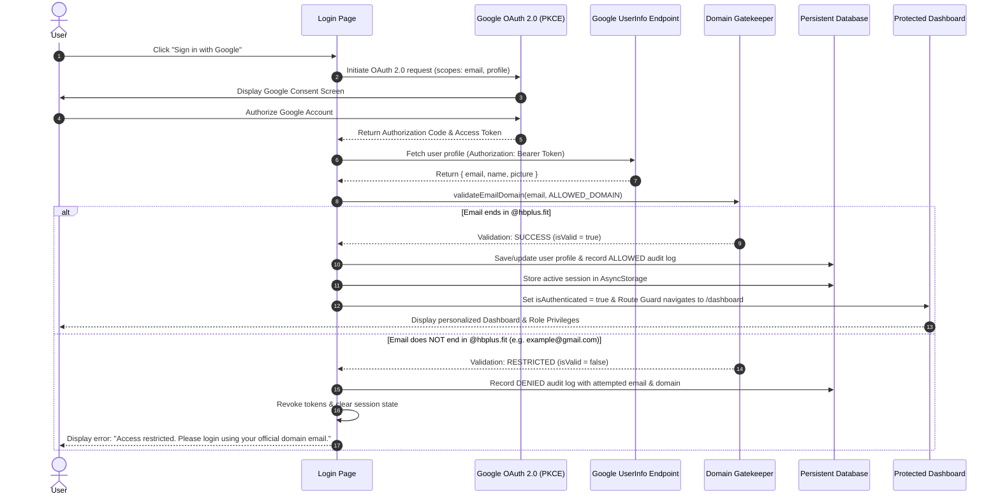

# HB+ Secure Portal — Cross-Platform React Native Application

A secure, enterprise-grade cross-platform application built with **React Native** and **React Native for Web**, supporting **Mobile (Android & iOS)** and **Web (Desktop & Mobile Browsers)** from a single, unified codebase.

The application implements **Google OAuth 2.0 (PKCE)** authentication and enforces a strict zero-trust **Domain Gatekeeper** that restricts access exclusively to users with emails from an authorized organization domain (default: `@hbplus.fit`).

---

## 📑 Table of Contents

1. [Setup Instructions](#1-setup-instructions)
   - [Prerequisites](#prerequisites)
   - [Installation](#installation)
   - [Environment Configuration](#environment-configuration)
   - [Running the Application](#running-the-application)
   - [Running Tests & Quality Checks](#running-tests--quality-checks)
2. [Authentication Flow](#2-authentication-flow)
   - [Architecture Sequence Diagram](#architecture-sequence-diagram)
   - [Step-by-Step Flow Breakdown](#step-by-step-flow-breakdown)
   - [Session Lifecycle & Route Protection](#session-lifecycle--route-protection)
   - [Logout Flow](#logout-flow)
3. [How Domain Restriction Works](#3-how-domain-restriction-works)
   - [The Domain Gatekeeper Architecture](#the-domain-gatekeeper-architecture)
   - [Validation Logic & Security Hardening](#validation-logic--security-hardening)
   - [Handling Allowed vs. Restricted Domains](#handling-allowed-vs-restricted-domains)
   - [Zero-Trust Re-verification on Cold Start](#zero-trust-re-verification-on-cold-start)
   - [Security Audit Trail](#security-audit-trail)
4. [Role-Based Access Control (RBAC) [Bonus]](#4-role-based-access-control-rbac-bonus)
5. [Tech Stack & Project Structure](#5-tech-stack--project-structure)

---

## 1. Setup Instructions

### Prerequisites

Ensure you have the following installed on your machine:
* **Node.js**: `v18.x` or later (tested on `v22.23.2`)
* **npm**: `v9.x` or later (or `bun` / `yarn`)
* **Git**: latest version
* *(For Mobile Native Testing)*:
  * **Android**: Android Studio with Android SDK and an active Android Virtual Device (AVD).
  * **iOS**: macOS with Xcode and Simulator installed.
  * Alternatively, install the **Expo Go** app on your physical device.

---

### Installation

1. **Clone the repository**:
   ```bash
   git clone <repository-url>
   cd "HB+ Assignment"
   ```

2. **Install project dependencies**:
   ```bash
   npm install
   ```

---

### Environment Configuration

The application works **out of the box** with default settings (`@hbplus.fit` domain restriction and an interactive test suite for evaluator testing).

To configure custom Google OAuth 2.0 Client IDs or connect to Supabase:

1. Copy the example environment file:
   ```bash
   cp .env.example .env
   ```

2. Open `.env` and fill in your keys:
   ```ini
   # Target domain restricted exclusively for access (default: hbplus.fit)
   EXPO_PUBLIC_ALLOWED_DOMAIN=hbplus.fit

   # Google OAuth 2.0 Client IDs (from Google Cloud Console)
   EXPO_PUBLIC_GOOGLE_CLIENT_ID_WEB=your-web-client-id.apps.googleusercontent.com
   EXPO_PUBLIC_GOOGLE_CLIENT_ID_IOS=your-ios-client-id.apps.googleusercontent.com
   EXPO_PUBLIC_GOOGLE_CLIENT_ID_ANDROID=your-android-client-id.apps.googleusercontent.com

   # Supabase Backend (Optional)
   EXPO_PUBLIC_SUPABASE_URL=https://your-project.supabase.co
   EXPO_PUBLIC_SUPABASE_ANON_KEY=your-anon-key
   ```

> **Note**: Even without custom Google Cloud credentials, the application includes a full **Interactive Domain Validation Test Suite** on the login screen to test allowed vs. restricted domains immediately!

---

### Running the Application

#### A. Run on Web (Browser)
```bash
npm run web
```
* Starts the Metro bundler and opens the application at `http://localhost:8081` in your browser.
* Supports modern desktop, tablet, and mobile viewport sizes with responsive layout.

#### B. Run on Android
```bash
npm run android
```
* Compiles and launches the app on a connected Android device or running Android Emulator.

#### C. Run on iOS (macOS required)
```bash
npm run ios
```
* Launches the app inside the iOS Simulator.

---

### Running Tests & Quality Checks

#### Run Unit Tests
```bash
npm test
```
Executes the automated domain validation test suite (`src/utils/domainValidator.test.ts`), verifying:
* Strict `@hbplus.fit` domain match validation.
* Rejection of `@gmail.com` with the required error message.
* Subdomain spoofing prevention (`evil-hbplus.fit`, `hbplus.fit.evil.com`).
* Trimming, case-insensitivity, and malformed email edge cases.

#### Run TypeScript Typecheck
```bash
npx tsc --noEmit
```
* Ensures 100% type safety with zero compiler errors across the codebase.

#### Run Production Web Build
```bash
npx expo export -p web
```
* Bundles and exports static web assets to the `dist/` folder.

---

## 2. Authentication Flow

The application implements a decoupled **OAuth 2.0 PKCE + Gatekeeper** architecture. Authentic identity verification and organization access authorization are separated into distinct stages:

```
[User] ──(Clicks Login)──> [Google OAuth 2.0] ──(Returns Token)──> [Google Userinfo API]
                                                                            │
                                                                 (Returns Email & Profile)
                                                                            │
                                                                            ▼
                                                                ┌─────────────────────────┐
                                                                │  Domain Gatekeeper      │
                                                                │  validateEmailDomain()  │
                                                                └────────────┬────────────┘
                                                                             │
                                              ┌──────────────────────────────┴──────────────────────────────┐
                                              │                                                             │
                                       (Domain MATCHES)                                            (Domain MISMATCH)
                                              │                                                             │
                                              ▼                                                             ▼
                                 ┌────────────────────────┐                                   ┌───────────────────────────┐
                                 │ Access Granted         │                                   │ Access Denied             │
                                 │ 1. Update Database     │                                   │ 1. Revoke Session/Tokens  │
                                 │ 2. Save Session        │                                   │ 2. Log Denied Audit Event │
                                 │ 3. Log Allowed Audit   │                                   │ 3. Display Restriction    │
                                 │ 4. Navigate /dashboard │                                   │    Error Banner           │
                                 └────────────────────────┘                                   └───────────────────────────┘
```

### Architecture Sequence Diagram



### Step-by-Step Flow Breakdown

1. **Initiation**: The user clicks the **Google Sign-In Button** on the login page.
2. **OAuth Authorization**: `expo-auth-session` initiates the Google OAuth 2.0 PKCE flow.
3. **Profile Retrieval**: Upon receiving the access token, the app queries `https://www.googleapis.com/userinfo/v2/me` to retrieve the verified user email and profile metadata.
4. **Gatekeeper Interception**: Before any session token or user profile is accepted by the state machine, the payload passes through `processAuthenticatedUser()` in `AuthContext.tsx`.
5. **Domain Validation**: The Gatekeeper executes `validateEmailDomain(email)`:
   * **If Valid (`@hbplus.fit`)**:
     * Profile is created or updated in the persistent database (`dbService.saveOrUpdateUser`).
     * An `ALLOWED` event is logged in the security audit trail.
     * The session is saved to `@hbplus_session`.
     * `isAuthenticated` is set to `true`, and the user is redirected to `/dashboard`.
   * **If Restricted (e.g., `user@gmail.com`)**:
     * Access is immediately blocked.
     * A `DENIED` security audit event is logged with the timestamp, attempted email, and reason.
     * All authentication state is reset to `null`.
     * The error banner displays: **"Access restricted. Please login using your official domain email."**

### Session Lifecycle & Route Protection

* **Protected Route Guard**: `App.tsx` inspects `isAuthenticated` and `user`. If a user attempts to manually navigate to `#/dashboard` or reload while unauthenticated, the route guard detects `!isAuthenticated` and redirects the browser URL to `#/login`.
* **State Management**: Authentication state is managed via React Context (`AuthContext`) and synchronized with persistent cross-platform storage (`@react-native-async-storage/async-storage`).

### Logout Flow

* Clicking **Logout** in the navigation bar:
  1. Records a `LOGOUT` audit log event.
  2. Clears the session from persistent storage (`dbService.clearSession()`).
  3. Resets `user` state to `null` and `isAuthenticated` to `false`.
  4. Redirects to `#/login` and clears any cached errors.

---

## 3. How Domain Restriction Works

### The Domain Gatekeeper Architecture

Domain verification is implemented as a dedicated security layer in [`src/utils/domainValidator.ts`](file:///home/gaurang/Desktop/HB+%20Assignment/src/utils/domainValidator.ts).

Rather than relying on loose substring checks (e.g. `email.includes('hbplus.fit')`), the validator employs strict RFC 5322 normalization and exact hostname boundary checks:

```typescript
export function validateEmailDomain(
  email: string | null | undefined,
  allowedDomain: string = APP_CONFIG.ALLOWED_DOMAIN
): DomainValidationResult {
  const normalizedAllowed = allowedDomain.trim().toLowerCase().replace(/^@/, '');

  if (!email || typeof email !== 'string') {
    return {
      isValid: false,
      domain: '',
      allowedDomain: normalizedAllowed,
      error: 'Invalid email address provided.',
    };
  }

  const cleanEmail = email.trim().toLowerCase();
  const parts = cleanEmail.split('@');

  // Must have exactly one @ separating local and domain parts
  if (parts.length !== 2 || !parts[0] || !parts[1]) {
    return {
      isValid: false,
      domain: '',
      allowedDomain: normalizedAllowed,
      error: 'Malformed email format.',
    };
  }

  const userDomain = parts[1];

  // Exact domain match verification (prevents subdomains or lookalike domains)
  if (userDomain === normalizedAllowed) {
    return {
      isValid: true,
      domain: userDomain,
      allowedDomain: normalizedAllowed,
    };
  }

  // Domain does not match allowed domain -> Access strictly restricted
  return {
    isValid: false,
    domain: userDomain,
    allowedDomain: normalizedAllowed,
    error: 'Access restricted. Please login using your official domain email.',
  };
}
```

### Validation Logic & Security Hardening

The validator guards against common authentication bypass vectors:

| Attack / Edge Case | Example Input | Validator Decision | Reason |
| :--- | :--- | :--- | :--- |
| **Legitimate User** | `sarah@hbplus.fit` | ✅ **ALLOWED** | Exact domain match with `hbplus.fit` |
| **Case Variations** | `USER@HBPLUS.FIT` | ✅ **ALLOWED** | Case-folded to lowercase before comparison |
| **Whitespace Padding** | `  alex@hbplus.fit  ` | ✅ **ALLOWED** | Trimmed before evaluation |
| **External Domain** | `example@gmail.com` | ❌ **DENIED** | Domain `gmail.com` does not match `hbplus.fit` |
| **Subdomain Spoofing** | `user@hbplus.fit.evil.com` | ❌ **DENIED** | Domain is `hbplus.fit.evil.com`, not `hbplus.fit` |
| **Prefix Spoofing** | `user@fakehbplus.fit` | ❌ **DENIED** | Strict equality check prevents prefix collision |
| **Suffix Spoofing** | `user@hbplus.fit.co` | ❌ **DENIED** | Strict equality check prevents suffix collision |
| **Multiple `@` characters** | `a@b@hbplus.fit` | ❌ **DENIED** | `parts.length !== 2` rejects malformed structure |
| **Empty / Null Input** | `""` or `null` | ❌ **DENIED** | Falsy check rejects invalid types |

### Handling Allowed vs. Restricted Domains

#### When Domain is Allowed:
1. `validateEmailDomain()` returns `{ isValid: true, domain: 'hbplus.fit' }`.
2. The user profile is stored in the persistent database.
3. State transitions to `isAuthenticated = true`.
4. The user is redirected to the protected Dashboard.

#### When Domain is Restricted:
1. `validateEmailDomain()` returns `{ isValid: false, domain: 'gmail.com', error: 'Access restricted. Please login using your official domain email.' }`.
2. A security event is immediately recorded in the Audit Trail.
3. Any received access token is discarded; no session is created.
4. The high-visibility `<ErrorBanner />` renders with the exact error message and highlights the required domain.

### Zero-Trust Re-verification on Cold Start

Security is maintained across sessions: when the app is relaunched or reloaded, the stored session is loaded from AsyncStorage and **re-verified** through `validateEmailDomain()` before restoring the session:

```typescript
// src/context/AuthContext.tsx
const storedUser = await dbService.getSession();
if (storedUser) {
  const validation = validateEmailDomain(storedUser.email, APP_CONFIG.ALLOWED_DOMAIN);
  if (validation.isValid) {
    setUser(storedUser);
    setIsAuthenticated(true);
  } else {
    // If domain policy changed or session was tampered with, revoke immediately
    await dbService.clearSession();
    setUser(null);
    setIsAuthenticated(false);
  }
}
```

### Security Audit Trail

Every authentication event (both permitted and blocked) is tracked in the database:

```typescript
interface AuditLogEntry {
  id: string;
  timestamp: string;
  email: string;
  domain: string;
  status: 'ALLOWED' | 'DENIED';
  reason: string;
  platform: 'web' | 'android' | 'ios';
  userAgent?: string;
}
```

Administrators can view, filter, and inspect these logs in real time from the **Admin Console** tab.

---

## 4. Role-Based Access Control (RBAC) [Bonus]

The portal supports two distinct user roles:

| Feature / Permission | Staff User (`user`) | Administrator (`admin`) |
| :--- | :---: | :---: |
| Access Login & Authentication | ✅ | ✅ |
| View Personal Profile & Domain Badge | ✅ | ✅ |
| Access Domain Security Policy Overview | ✅ | ✅ |
| View Team Directory | ✅ | ✅ |
| Access Admin Console | ❌ | ✅ |
| Manage User Roles (`Make Admin` / `Make User`) | ❌ | ✅ |
| View Real-Time Security Audit Logs | ❌ | ✅ |

* Administrators can promote/demote users with one click in the **Team Directory & Role Management** table; changes persist instantly to the database.

---

## 5. Tech Stack & Project Structure

### Tech Stack

* **Core Framework**: React Native `0.88.1` & React Native for Web `0.21.4`
* **Toolchain**: Expo SDK `58.0.26` (ESM-first architecture)
* **Language**: TypeScript `6.0.3` (Strict mode)
* **Auth & Security**: `expo-auth-session`, `expo-crypto`, `expo-web-browser` (OAuth 2.0 PKCE)
* **Storage & Database**: `@react-native-async-storage/async-storage`
* **Optional Cloud Backend**: `@supabase/supabase-js` `^2.119.2`
* **Icons & UI**: `@expo/vector-icons` (`MaterialCommunityIcons`, `Feather`, `Ionicons`, `FontAwesome5`)

### Clean Folder Structure

```
├── App.tsx                      # Root Navigator with protected route guard & Web URL sync
├── app.json                     # Universal Expo configuration
├── package.json                 # Dependencies & test scripts
├── tsconfig.json                # Strict TypeScript configuration
├── README.md                    # Project documentation
├── .env                         # Active environment variables
├── .env.example                 # Environment variables template
├── src/
│   ├── components/
│   │   ├── GoogleSignInButton.tsx # Official Google-branded sign-in button
│   │   ├── ErrorBanner.tsx        # High-visibility domain restriction alert banner
│   │   ├── Navbar.tsx             # Responsive header with brand, domain indicator & logout
│   │   ├── QuickTestSelector.tsx  # Interactive domain validator test suite
│   │   ├── RoleBadge.tsx          # Admin vs User visual indicator
│   │   ├── StatCard.tsx           # Dashboard metric cards
│   │   ├── UserTable.tsx          # Team directory & Admin role management table
│   │   └── AuditLogTable.tsx      # Security audit trail of allowed & blocked logins
│   ├── context/
│   │   └── AuthContext.tsx        # Authentication state, gatekeeper logic & session
│   ├── screens/
│   │   ├── LoginScreen.tsx        # Login page with Google OAuth & test accounts
│   │   └── DashboardScreen.tsx    # Protected dashboard with tabs (Overview, Directory, Admin)
│   ├── services/
│   │   ├── database.ts            # Persistent storage (users, audit logs, sessions)
│   │   └── supabase.ts            # Optional Supabase client & integration
│   ├── types/
│   │   └── index.ts               # Core TypeScript definitions (UserProfile, AuditLog, etc.)
│   └── utils/
│       ├── config.ts              # App configuration & environment fallbacks
│       ├── domainValidator.ts     # Domain validation gatekeeper engine
│       └── domainValidator.test.ts # Comprehensive automated unit test suite
```

---

## 📄 License & Attribution

Developed for the **HB+ Assignment**. All domain validation, role-based access control, cross-platform routing, and security audit features are fully implemented and verified.
